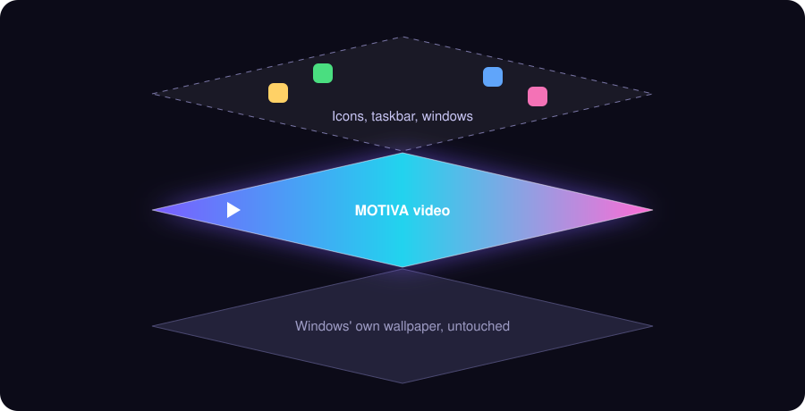
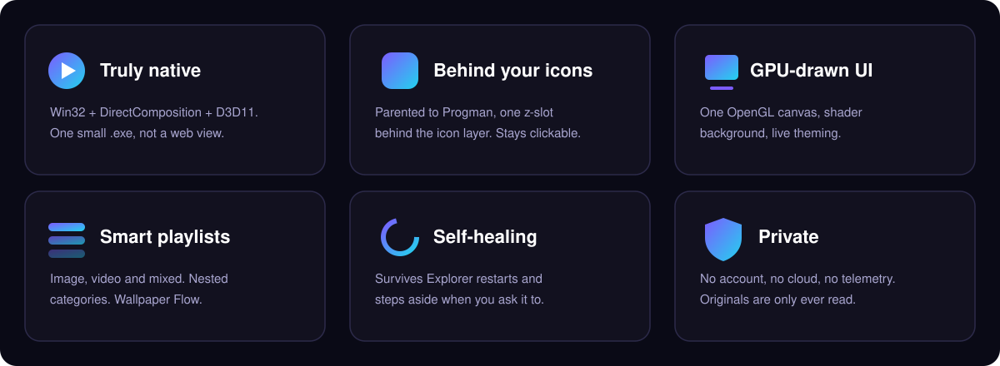
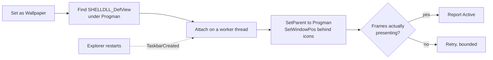

<div align="center">


**Video, GIF and image-slideshow wallpapers for Windows, running *behind* your icons.**<br/>
Native C++ · Qt 6 · Win32 · DirectComposition · a GPU-drawn UI. No Electron. No browser. No fake fullscreen window.

<br/>

[](https://github.com/guptaji0358/Motiva/releases)
[](#)
[](#building)
[](#privacy-by-design)

[**Download**](https://github.com/guptaji0358/Motiva/releases) &nbsp;·&nbsp; [**Website**](website) &nbsp;·&nbsp; [**How it works**](#under-the-hood) &nbsp;·&nbsp; [**Build it**](#building)

<br/>




<sub>Three layers. Motiva lives in the middle, so your icons stay on top.</sub>

</div>

## Why it feels different




## Feature tour

<details open>
<summary><b>🎬 Play anything</b></summary>

- Video (MP4, MKV, MOV, AVI, WMV, OGV), animated GIFs and still images
- Drag & drop, **Open Video**, or paste a direct `http(s)` link with `Ctrl+V`
- All monitors, primary only, or one specific display
- Fill / Fit / Stretch / Original scaling
- Play, pause, mute, volume, loop
- *Show video on battery* control so laptops stay in charge of their own power

</details>

<details open>
<summary><b>📚 Playlists that think</b></summary>

- **Image**, **video** and **mixed** playlists in a local SQLite library (`.mtv`)
- Images rotate on unlock, on Windows start, or on an interval; videos advance when they end
- **Categories** per playlist: rule-based or hand-picked, nestable, with *include subcategories*
- **Wallpaper Flow**: a node diagram for reordering with undo/redo, zoom, shortcuts and A-Z / Z-A

</details>

<details>
<summary><b>🎨 Make it yours</b></summary>

- Four built-in themes: Dark/Light **Aurora**, Dark/Light **Onyx**
- Theme editor with per-color overrides, accent presets and automatic **WCAG contrast fixes**
- Tabs, sidebar or grouped Settings layouts
- A custom Motiva tooltip and toast system that follow your theme

</details>

<details>
<summary><b>🧰 Quality-of-life</b></summary>

- Cascading **Motiva ▸** Explorer right-click menu: set as background, add to a playlist, make a new one
- **Find File** / **Find All at Once** recover moved media in a single pass over your drives
- Optional local **media backup** (off by default) and a **Cleanup & Reset** window
- Start with Windows, Start Menu entry, tray control
- A second launch hands off to the running instance instead of silently doing nothing

</details>

## What's new in v2.0.0

The GPU-drawn interface, mixed playlists, nested categories, Wallpaper Flow, the theme editor,
the Explorer menu, missing-media recovery, unified notifications and a much sturdier startup:
the window appears immediately and desktop attach, media restore and hand-offs follow behind it.

## Under the hood

All raw Win32 desktop logic lives in one file,
[`WindowsDesktopWallpaper.cpp`](scripts/src/WindowsDesktopWallpaper.cpp), and nowhere else.



1. **Find the icon layer.** On current Windows 11 builds no standalone icon-less `WorkerW` exists, so Motiva attaches to `Progman` directly.
2. **A real window, not a widget.** The render surface is a native Win32 window with `WS_EX_NOREDIRECTIONBITMAP`, drawn via DirectComposition and Direct3D 11.
3. **Place it once.** Parented to `Progman`, z-ordered directly behind `SHELLDLL_DefView`, with no later z-order upkeep and so no flicker.
4. **Never block the UI.** Attach runs off-thread; stale results are discarded if an Explorer restart moved the *attach generation* on.
5. **Honest status.** "Active" means frames are being presented, not merely that `SetParent` returned true.
6. **Recover on its own.** Explorer restarts are caught via `TaskbarCreated`, with a second launch as a safety net.
7. **Respect the user.** Motiva never writes your wallpaper setting, detaches if you pick a new one in Explorer, and only activates on an explicit *Set as Wallpaper*.

If attaching fails, the render window stays hidden rather than becoming a fake fullscreen overlay.

## Building

Requires Qt 6 (Widgets, Multimedia, OpenGL, OpenGLWidgets, SQL), the MinGW toolchain bundled with your Qt install, CMake and Ninja.

```bash
cmake -S . -B build -G Ninja -DCMAKE_PREFIX_PATH="<path-to-Qt>/6.x/mingw_64" -DCMAKE_BUILD_TYPE=Release
cmake --build build
```

> Use the MinGW that ships with Qt (e.g. `<Qt>/Tools/mingw1310_64`), not an unrelated MSYS2 install.
> Mixed CRTs cause `__imp___argc` link errors.

Installer (needs [Inno Setup 6](https://jrsoftware.org/isinfo.php)):

```powershell
installer\build-installer.ps1
```

This deploys the Qt runtime (including `Qt6OpenGL.dll` and `Qt6OpenGLWidgets.dll`) and writes `release\MotivaSetup.exe`.

<details>
<summary><b>Project layout</b></summary>

```text
Motiva/
├── scripts/
│   ├── main/main.cpp     entry point, single-instance lock, logging
│   ├── src/              UI, playlists, library, wallpaper, Win32
│   └── include/          headers
├── resources/            app.rc, manifest, Qt resources
├── Assets/               icons and artwork, organised by feature
├── installer/            Inno Setup script and build pipeline
├── website/              static project website
└── CMakeLists.txt
```

Key pieces: `GlUi` / `GlWindow` / `GlPopups` (GL toolkit), `PlaylistLibrary` / `LibraryDatabase` (SQLite),
`FlowDialog`, `ThemeEditorDialog`, `NotificationManager`, `CleanupManager`, `BackupManager`,
`MediaRecovery`, `WallpaperManager`, `D3DWallpaperRenderer`, `WindowsDesktopWallpaper`.
Deeper history lives in [`CLAUDE.md`](CLAUDE.md).

</details>

## Privacy by design

- Preferences: `HKCU\Software\Motiva`
- Library: a `.mtv` SQLite file in local app data
- Log: `%TEMP%\Motiva.log`
- Nothing leaves your PC. Backups are local, opt-in, and originals are only read.

## Honest limitations

- Motiva relies on Explorer's undocumented desktop hierarchy, like every Windows video-wallpaper tool. A future Windows update may need a small fix in `WindowsDesktopWallpaper.cpp`.
- Built and tested on Windows 11; multi-monitor setups with mixed resolutions have had limited testing.
- The GL interface has no screen-reader support yet, and there is no reduced-motion setting.
- No automatic pause on idle or lock yet.
- Moving wallpapers use more power than a static one; use *Show video on battery* on laptops.

<br/>

<div align="center">

**Made by [Robin Gupta](https://github.com/guptaji0358)** · RGS™ · Built with Claude

<sub>Copyright © Robin Gupta</sub>

</div>
